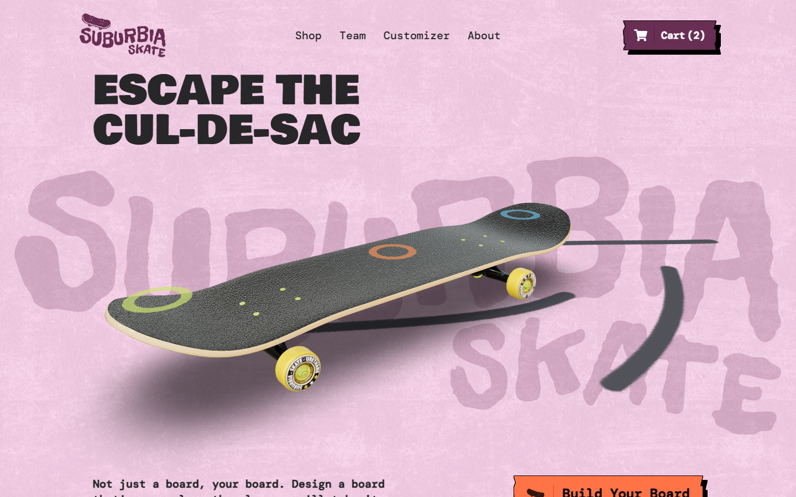

# Suburbia Skateboards

A skate shop built with **Next.js 15 (App Router)**, **Prismic** as the headless CMS and
**React Three Fiber** for a 3D board builder. You can browse the boards, open a product page,
design a custom complete in 3D, keep it all in a cart that survives reloads, and check out
through **Stripe in test mode** or a clearly labelled **mock checkout**.

Live demo: https://suburbia-solo.netlify.app/ (Netlify builds `main`).



## What it does

| Route | What you get |
|---|---|
| `/` | Prismic slice zone: 3D hero board you can click to ollie and kickflip, product grid, sticky story sections, video, team, physics footer. |
| `/boards` | Every board from Prismic as a grid, plus `ItemList` structured data. |
| `/boards/[uid]` | Product page: price, description, quantity, add to cart, "Customize this board". Statically generated per product, with its own title, description, canonical URL, Open Graph image and `Product` + `BreadcrumbList` JSON-LD. |
| `/build` | 3D builder: 11 deck graphics, 9 wheels, 6 truck and bolt finishes. "Add to cart" saves the exact design. `?deck=oni-mask&wheel=pink&truck=gold&bolt=silver` opens a design (the cart's **Edit** link uses this). |
| Cart drawer | Opens from the nav on every page. Quantity, remove, edit custom design, subtotal. Saved in `localStorage`, validated on load, synced across tabs. |
| `/checkout` | Contact + shipping form and order summary. Posts to `/api/checkout`. |
| `/checkout/success` | Confirmation for the mock order, or the Stripe session status. |
| `/sitemap.xml`, `/robots.txt` | Generated from the catalogue. |

### How the pieces fit

- **Content.** `src/lib/prismicio.ts` builds the Prismic client. Pages fetch on the server;
  the homepage passes products and skaters to the slices through the slice-zone `context`,
  so no slice fetches from the browser.
- **Catalogue.** `src/lib/catalog.ts` turns Prismic `skateboard` documents into plain `Product`
  objects (name, price in cents, image, description, matching builder deck, accent colour).
- **Homepage copy.** The hero tagline, the board-wall blurb and the four story panels are written
  in code (`src/slices/*`), not Prismic, because they quote catalogue facts (deck count, wheel size,
  price) from `customizer-options.ts` and `COMPLETE_SPECS` in `src/lib/site.ts`. Prismic still
  supplies the headline, the featured boards and each panel's colour, layout and photos.
- **Builder options.** `src/lib/customizer-options.ts` is the single list of decks, wheels and
  metals. The 3D preview, the cart and the checkout API all validate against it.
- **Cart.** `src/lib/cart.ts` is a pure reducer plus a defensive `localStorage` parser;
  `src/contexts/CartContext.tsx` wires it into React.
- **Checkout.** `src/lib/checkout.ts` validates the order with zod, **re-prices every line on
  the server** (the browser's prices are display-only), then either returns a mock receipt or
  creates a Stripe Checkout Session.

## Run it

```bash
npm install
npm run dev            # http://localhost:3000, live content from the public Prismic repo
npm run dev:fixtures   # same, but content comes from src/fixtures (no network to Prismic)
```

No keys are needed for either: the Prismic repository `suburbia-solo` is publicly readable and
the checkout defaults to the mock.

Copy `.env.example` to `.env.local` to change anything:

| Variable | Needed for | Default |
|---|---|---|
| `NEXT_PUBLIC_SITE_URL` | Canonical URLs, OG images, sitemap, Stripe return URLs | Netlify's `URL`, else `http://localhost:3000` |
| `STRIPE_SECRET_KEY` | Real Stripe Checkout in **test mode** | unset → mock checkout |
| `PRISMIC_WEBHOOK_SECRET` | `POST /api/revalidate` (Prismic publish webhook) | unset → route refuses every call |
| `PRISMIC_ACCESS_TOKEN` | Only if the Prismic API is made private | unset |
| `PRISMIC_FIXTURES=1` | Read content from `src/fixtures` | off |
| `NEXT_PUBLIC_SHOP_CURRENCY` | Display + Stripe currency | `cad` |

### Checkout modes

| `STRIPE_SECRET_KEY` | Behaviour |
|---|---|
| not set | **Mock.** The page says "Demo checkout", asks for a shipping address, and the API returns a receipt with an order reference. Nothing is stored, charged or shipped. |
| `sk_test_…` / `rk_test_…` | **Stripe test mode.** Redirects to hosted Stripe Checkout (Stripe collects the address and card). Pay with `4242 4242 4242 4242`, any future date, any CVC. The success page reads the session back from Stripe. |
| anything else (a live key) | **Refused.** The API answers 503 and logs why. This is a portfolio demo and must not take real money. |

There are no user accounts, so there are no demo logins. `/api/checkout` is intentionally
public (guest checkout); it accepts JSON only, caps the body at 16 KB, validates every field
and rejects unknown boards, unknown builder options and client-supplied prices.

### Prismic fixtures

`src/fixtures/prismic-documents.json` is a snapshot of every published document. The client
uses it when `PRISMIC_FIXTURES=1`, and falls back to it automatically if the Prismic API cannot
be reached. Image URLs are rewritten to web-sized WebP copies in `public/Images/web`
(`python scripts/build-web-images.py`), so fixture mode needs no Prismic access at all. Refresh it with `npm run snapshot:prismic`.

### Content model change to push

`customtypes/skateboard/index.json` gains two optional fields: **Description** (rich text) and
**Customizer deck** (select). They are not in the live repository until pushed with Slice
Machine (`npm run slicemachine` → Push). Until then the product copy and deck mapping come from
`PRODUCT_EXTRAS` in `src/lib/catalog.ts`, and once the fields are filled in Prismic they win.

## Tests

```bash
npm run typecheck
npm test            # 71 unit + API tests (vitest), offline: fixtures + stubbed Stripe
npm run test:e2e    # Playwright: builds into .next-e2e, serves on :4311 with fixtures + mock checkout
```

- `tests/cart.test.ts`: reducer, limits, merging, the `localStorage` parser dropping bad data.
- `tests/customizer-options.test.ts`: every option has its texture files; URL round-trips.
- `tests/checkout.test.ts`: zod schema (tampered prices, bad quantities, unknown options),
  server-side pricing, the Stripe request body, live-key refusal, session lookup.
- `tests/api-checkout.test.ts`: the real `POST /api/checkout` handler in mock and Stripe modes.
- `tests/revalidate.test.ts`: the webhook refuses without the right secret.
- `tests/catalog.test.ts`: fixture API, catalogue normalisation, per-product metadata and JSON-LD
  (and that no ratings are invented).
- `tests/zine.test.ts`: ransom-note headline tiles (deterministic, so server and browser
  match), price sticker copy, confirmation sticker ring, builder Shuffle.
- `tests/checkout-form.test.ts`: the checkout's own field error messages.
- `e2e/shop.spec.ts`: home → product page (title, canonical, JSON-LD) → add 2 → reload keeps
  the cart → builder preset → add custom → checkout (blank submit shows the designed field
  errors) → demo order confirmed and cart emptied; the branded 404; and at 390px: no sideways
  scrolling, touch-visible card buttons, the one-screen builder (tabs, rails, Shuffle), the
  full-screen menu and the sticky buy bar.

Set `PLAYWRIGHT_CHROMIUM_PATH` if Playwright's own Chromium is not installed.

## Assets and scripts

| Command | What it does |
|---|---|
| `npm run textures` | `scripts/build-textures.py` (Python + Pillow): turns the 2056×4096 deck PNGs in `assets/images` into 1028×2048 WebP textures plus cut-out swatches in `public/textures`. About 5-10× smaller, which keeps deck switching instant. |
| `npm run model` | `scripts/pack-glb.mjs`: packs `assets/model/skateboard.gltf` + `.bin` into `public/skateboard.glb`. |
| `npm run snapshot:prismic` | Refreshes the content fixtures. |
| `python scripts/build-web-images.py` | Web-sized WebP copies of every image the fixtures use (plus the footer photo), in `public/Images/web`. |

The full-size source PNGs (~68 MB) and the source HDRI live in `assets/`, outside `public/`, so they
are not deployed; the site only serves the WebP copies, the textures and the Draco `.glb`.

The model ships as one `.glb` partly for one fewer request and partly because a network
filter on the development machine answered any plain-HTTP `*.bin` request with an empty 204,
which crashed the 3D scenes. The 3D canvases are also wrapped in an error boundary now, so a
WebGL or asset failure shows a fallback instead of taking down the page.

## Screenshots

`revamp-shots/` (1440×900 unless noted):

1. `01-home.png`: homepage hero (the 3D board drops in; tap the dots for tricks)
2. `02-boards.png`: the rack
3. `03-product-page.png`: product page
4. `04-builder.png`: 3D builder
5. `05-cart-drawer.png`: cart drawer with a catalogue board and a custom build
6. `06-checkout.png`: demo checkout
7. `07-order-confirmed.png`: confirmation with the printed receipt
8. `08-404.png`: branded 404
9. `09-phone-home.png`, `10-phone-builder.png`: 390×844
10. `11-home-story.png`: the story's parts panel (dimensioned deck + spec strip)
11. `12-phone-shop.png`, `13-phone-404.png`: 390×844

## Credits

Built by Solomon Olufelo. Started from the Prismic "Suburbia" 3D skateboard tutorial and
extended into a working shop: cart, product pages, builder-to-cart, checkout, SEO, fixtures
and tests. Skateboard brand and products are fictional.
